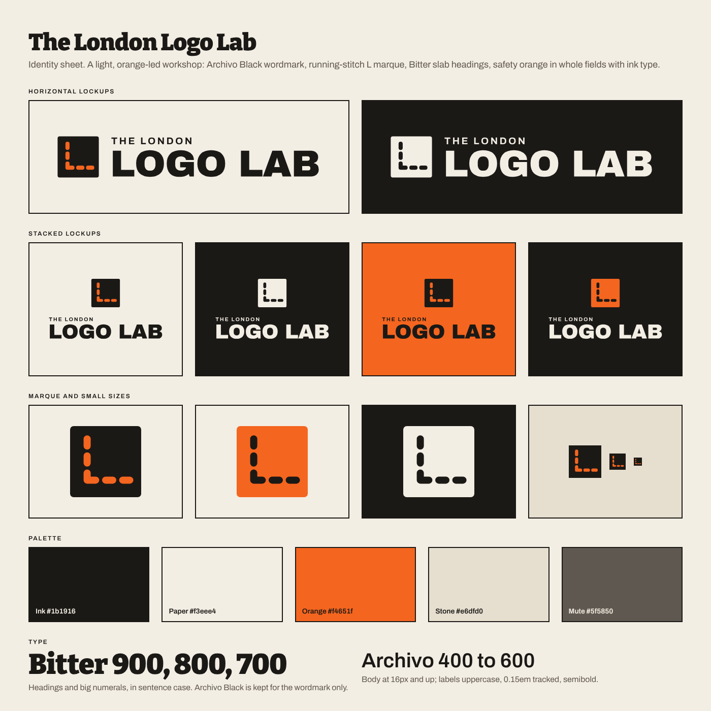

# The London Logo Lab — identity

Direction: **Bold workshop.** Confident, trade-friendly, reads on a van door and a polo chest. Not an I&A-branded site; the group link is a footer line only.

## Name treatment

- **LOGO LAB** is the strong word: Archivo Black, upper case, tracked slightly tight (−0.015em).
- **THE LONDON** sits above it, left aligned: Archivo Bold at 26% of the big size, tracked 0.18em.
- The two lines share a left edge. Nothing is ever set in Archivo Black below 18px.
- Written in prose: "The London Logo Lab" on first mention, "Logo Lab" after that. Never "LLL".

## Marque: the running-stitch L

Five stitches on a square tile make an L: three down, the third turns the corner, two along the foot. It is the first letter of the strong word drawn with the first thing the workshop does. Round-capped strokes at 10% of the tile, gaps wide enough to survive 16px (favicon) and embroidery at 20mm. Tile corners are 5% of the edge; the full-bleed icon version is square.

The marque is also the "position marker" idea on the site: the mock-up's dashed boxes show where the stitch goes, and the job ticket's tick is the marque tile with a thread tick.

## Lockups (`public/img/logo/`)

| File | Use |
| --- | --- |
| `logolab-horizontal-ink.svg` | Header, documents, anything on paper or stone |
| `logolab-horizontal-paper.svg` | Footer, dark grounds |
| `logolab-horizontal-orange.svg` | Orange tile + paper text on ink, for van sides and signage |
| `logolab-stacked-ink.svg`, `-paper.svg` | Square-ish spaces: labels, social avatars with a border, embroidery on a chest |
| `logolab-stacked-ink-bg.svg`, `-orange-bg.svg` | Self-contained tiles with their own background |
| `logolab-marque-ink.svg`, `-orange.svg`, `-paper.svg` | Marque alone: small spaces, sleeve embroidery, stamps |
| `logolab-marque-icon.svg` + `favicon-64.png`, `apple-touch-icon.png`, `icon-512.png` | Full-bleed app and tab icons |

All lockups are outlined paths built by `scripts/logo.py` (fontTools over the Google Fonts files from `@fontsource/archivo-black` and `@fontsource/archivo`), so they need no fonts installed. Raster assets and this sheet come from `scripts/brand-assets.mjs`.

Clear space: the height of the marque tile on all sides. Minimum width: 120px horizontal, 80px stacked, 16px marque.

## Palette

| Token | Hex | Role |
| --- | --- | --- |
| Paper | `#f3eee4` | The ground of every page, the ticket and the footer |
| Orange | `#f4651f` | Laid down in whole fields: the home hero, one band or title field on a page. Type on it is Ink (5.6:1). Also the button fill. Never text on paper |
| Ink | `#1b1916` | Type and 2px borders. Never a ground: no ink hero, band, footer or bar |
| Stone | `#e6dfd0` | The bench the ticket lies on; the neutral band; photo slots |
| Mute | `#5f5850` | Secondary text on paper (6.0:1) and stone (5.3:1). Not used on orange |
| Rust | `#b54106` | The stamp and the stitched title rule on paper: 4.9:1 |
| Line | `#d9d1c2` | Hairlines and unchosen option borders |

Orange-deep `#d9530f` is the hover state for orange buttons. No gradients. No alpha text.

## Type

Each business in the group owns one class of letter. The London Logo Lab owns the **heavy slab**: the lettering of a workwear label and a print-shop poster.

- **Bitter** (Google Fonts, weights 700, 800, 900): 900 for the home headline, page titles (h1) and large numerals such as the ticket total; 800 for section titles (h2) and column heads; 700 for h3 and the ticket's title. Sentence case. Tracking -0.01em (about -0.018em with a little extra word space at headline size, 0 on h3); leading 1.0 on the headline, about 1.05 on titles, 1.2 on h3. The home headline is sized to run the width of the page on two lines.
- **Archivo** (400, 500, 600): all text, labels and controls, 17px with 1.6 leading and lines of 45 to 75 characters.
- **Archivo Black** is the wordmark only. It lives in the outlined logo SVGs and is not loaded by the site.
- The voice is friendly: sentence case everywhere (headings, buttons, links), short lines, plain workshop words. Upper case is kept for the wordmark, the stamp, the lines of the job ticket and filter names (12px, 0.15em).
- One fluid scale lives in `src/index.css` (`--step-hero` to `--step-small`). Fonts load from Google Fonts in `index.html`; change `--font-display` and `--font-sans` in `src/index.css` only.

## Page furniture

- **Header:** one bar on paper with a 2px ink rule. The lockup, the pages as plain words, and "1 item minimum, ready within 7 days" as a rust stamp at the right. No strip above it. On a phone: lockup, an orange Quote button and the menu.
- **Home hero:** an orange field. The headline across the full width, then the garment drawing on a paper sheet and the working job ticket side by side on the orange, like a job on a print table.
- **Sequences:** numbered orange tiles on one stitched ink thread, across the page on a desktop and down the left edge on a phone.
- **Footer:** paper, shaped like the bottom stub of the ticket: a line of punched holes, the promise and the quote button on the left, the links as two short lines on the right, then the family and legal line, which carries the preview notice.

## Shapes and motion

- Corners 3px everywhere (buttons, tiles, inputs); the marque tile is the one exception at 5%.
- Borders are 2px ink; rules between rows are 1px ink.
- **The job ticket** is the site's signature: a paper ticket with a running-stitch border in orange (the marque's stitch), a perforated tear line above the total, the confirmed terms as a rust stamp in the header, and a stitched tick on each line once it is chosen. The stitch border appears only on the ticket; a short stitched rule sits under page titles and one thread joins the steps of a sequence. Nothing else is stitched.
- No rule grids, gradients or drop shadows.
- Motion answers an action: a ticket line opening, a tick stitching in, the drawing changing. The hero ticket arriving is the one unprompted moment. `prefers-reduced-motion` switches all motion off.
- Focus: 2px ink ring with an orange halo on paper and stone; 3px ink ring with a paper halo on an orange field.

## Illustration

Flat garment drawings (`src/components/Garment.tsx`) in one 200×220 viewBox: cloth filled from the garment's colour list, 1.5px ink outline, seams at 55% in the contrast colour, hi-vis tape in a fixed silver. Logo positions are dashed orange boxes with a cross; uploaded artwork sits inside the box. Method close-ups (`MethodCloseUp.tsx`): one round loupe on the cloth showing the foot of the marque's L made four ways: satin stitch rows, screen mesh dots, a DTF film peeling, cut vinyl with the waste lifting. Same 1.5px ink outline and flat fills.

Photos are limited to two per page and otherwise replaced by labelled photo slots in stone. No faces.
